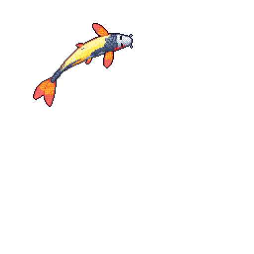
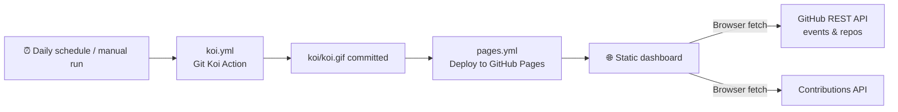

<div align="center">

# 🐟 GitHub Koi Dashboard

### Turn your GitHub activity into a living, interactive aquarium

Animated pixel-art koi · Contribution history · Public activity insights · Language breakdown

[](LICENSE)
[](https://loganthp.github.io/LoganthP/koi/)
[](#-data-sources--limitations)
[](#-privacy--security)
[](CONTRIBUTING.md)

[**🌊 Live Demo**](https://loganthp.github.io/LoganthP/koi/) ·
[**📖 Setup Guide**](docs/SETUP.md) ·
[**🐛 Report a Bug**](../../issues) ·
[**✨ Request a Feature**](../../issues)

<br/>

<a href="https://loganthp.github.io/LoganthP/koi/">
  
</a>

</div>

---

## 📑 Table of Contents

- [About](#-about)
- [Features](#-features)
- [Preview](#-preview)
- [How It Works](#-how-it-works)
- [Quick Start](#-quick-start)
- [Configuration](#-configuration)
- [Local Development](#-local-development)
- [Embed in Your Profile README](#-embed-in-your-profile-readme)
- [Repository Layout](#-repository-layout)
- [Data Sources & Limitations](#-data-sources--limitations)
- [Privacy & Security](#-privacy--security)
- [FAQ](#-faq)
- [Roadmap](#-roadmap)
- [Contributing](#-contributing)
- [Credits](#-credits)
- [License](#-license)

---

## 🌊 About

**GitHub Koi Dashboard** is a fully static, customizable GitHub Pages app that combines a generated pixel-art koi with your public GitHub activity — no server, no database, no API keys.

Drag the fish around, let it follow your cursor, switch aquarium themes, resize it, and scroll through a year of contributions, all in one place.

> **Attribution:** The aquarium/dashboard is an independent frontend built by [Loganth](https://github.com/LoganthP).
> The koi GIF is generated by Anthony Yalong's MIT-licensed [Git Koi](https://github.com/yalongwastaken/git-koi) action. This project does not claim ownership of that generator.

---

## ✨ Features

| Category | What you get |
| --- | --- |
| 🐟 **Interactive Koi** | Drag-and-drop movement and cursor-follow mode |
| 🎨 **Customization** | Multiple aquarium themes and adjustable fish size |
| 🟩 **Contributions** | Full-year contribution graph with scrollable history and GitHub-style green intensity |
| 📈 **Activity** | Recent public event totals, event-type breakdown and activity timeline |
| 💻 **Languages** | Breakdown of repositories by primary language |
| 🕒 **Patterns** | Time-of-day and weekday distribution of public events |
| 🧰 **Tech Stack** | Editable technology stack grid |
| 🔄 **Automation** | Daily koi regeneration via GitHub Actions |
| 🌐 **Zero Backend** | Pure static site on GitHub Pages — no server, database or secrets |
| 📱 **Responsive** | Mobile-friendly layout |

---

## 🖼️ Preview

<!-- Replace with real screenshots: save them in docs/assets/ and update the paths -->

<div align="center">

| Aquarium | Insights |
| :---: | :---: |
|  |  |

</div>

---

## ⚙️ How It Works



1. **Generate** — `koi.yml` runs the Git Koi action daily (or on demand) and commits `koi/koi.gif`.
2. **Deploy** — `pages.yml` publishes the static site to GitHub Pages.
3. **Render** — When someone opens the page, their browser fetches public data directly from GitHub and the contributions API. Nothing runs on a server.

---

## 🚀 Quick Start

> **Prerequisite:** a GitHub account. That's it.

1. **Create a public repository** (recommended name: `github-koi-dashboard`) and add the files from this project.
2. **Edit [`config.js`](config.js)** — set your GitHub username and other public profile values.
3. **Customize the tech stack** — edit the tech-stack cards in `index.html`.
4. **Generate your koi** — go to **Actions → Generate koi → Run workflow**. This creates `koi/koi.gif`.
5. **Enable Pages** — go to **Settings → Pages** and set the source to **GitHub Actions**.
6. **Visit your aquarium** at:

   ```text
   https://YOUR_USERNAME.github.io/github-koi-dashboard/
   ```

📖 Need help? See the [complete setup and troubleshooting guide](docs/SETUP.md).

---

## 🛠️ Configuration

All public settings live in [`config.js`](config.js). Only put **public** information there — it is served to every visitor.

| What to change | Where |
| --- | --- |
| GitHub username & profile values | `config.js` |
| Tech-stack cards | `index.html` |
| Koi regeneration schedule | `.github/workflows/koi.yml` (`cron`) |
| Themes, styling, charts | `index.html` |

---

## 💻 Local Development

No npm, no build step. Just serve the folder:

```bash
# Python 3
python -m http.server 8000
```

Then open **http://localhost:8000/**.

> The fish only appears after the generator has run at least once and `koi/koi.gif` exists.

---

## 🪪 Embed in Your Profile README

Show your koi on your GitHub profile and link it to the full interactive aquarium:

```html
<p align="center">
  <a href="https://YOUR_USERNAME.github.io/github-koi-dashboard/">
    
  </a>
</p>
```

> **Note:** GitHub READMEs only display the static GIF. Dragging, themes and charts work on the GitHub Pages site.

---

## 📂 Repository Layout

```text
.
├── .github/workflows/
│   ├── koi.yml          # Generates koi.gif daily
│   └── pages.yml        # Publishes the static site to GitHub Pages
├── docs/
│   └── SETUP.md         # Detailed deployment & customization guide
├── koi/                 # Generated koi.gif lands here
├── config.js            # Public profile configuration
├── index.html           # Aquarium UI, styling and charts
├── README.md
├── CONTRIBUTING.md
├── SECURITY.md
├── THIRD_PARTY.md
└── LICENSE
```

---

## 📊 Data Sources & Limitations

| Area | Source | Notes |
| --- | --- | --- |
| 🐟 Koi | [Git Koi Action](https://github.com/yalongwastaken/git-koi) | Regenerated on schedule; the GIF may be cached by the browser or CDN |
| 🟩 Contributions | [github-contributions-api](https://github.com/jogruber/github-contributions-api) | Third-party service; may be delayed or temporarily unavailable |
| 📈 Events & insights | [GitHub Events API](https://docs.github.com/en/rest/activity/events) | Public events only; up to the 100 most recent. **Not** a complete contribution total |
| 💻 Languages | [GitHub Repos API](https://docs.github.com/en/rest/repos/repos) | Counts non-fork repos by primary language — **not** lines of code |

> ⚠️ Time-of-day and weekday charts reflect **when public events occurred**, not actual coding hours.

---

## 🔒 Privacy & Security

- ✅ Uses **public data only**
- ✅ **No GitHub token** or secret is embedded in the site
- ✅ No tracking, no database, no server
- ⚠️ Unauthenticated GitHub API requests are rate-limited per visitor IP

Found a vulnerability? Please follow [SECURITY.md](SECURITY.md) instead of opening a public issue.

---

## ❓ FAQ

<details>
<summary><b>The fish isn't showing up.</b></summary>

Make sure the **Generate koi** workflow has run successfully and `koi/koi.gif` exists in the repository. Then hard-refresh the page (<kbd>Ctrl</kbd>+<kbd>Shift</kbd>+<kbd>R</kbd>).
</details>

<details>
<summary><b>My koi didn't update after the daily run.</b></summary>

The GIF is probably cached. Wait a few minutes or hard-refresh. On your profile README, GitHub's image proxy may also cache it for a while.
</details>

<details>
<summary><b>Why don't the event numbers match my contribution graph?</b></summary>

The Events API only returns recent **public** events (up to 100), while the contribution graph covers the whole year. They measure different things.
</details>

<details>
<summary><b>Charts say "rate limit exceeded".</b></summary>

GitHub limits unauthenticated API requests per IP. Wait for the limit to reset (usually within an hour) and reload.
</details>

<details>
<summary><b>Can I use a different repository name?</b></summary>

Yes. Just use that name in your Pages URL and in the raw GIF URL when embedding.
</details>

---

## 🗺️ Roadmap

- [ ] More aquarium themes
- [ ] Export dashboard as an image
- [ ] Multiple fish / school mode
- [ ] Theme selection via `config.js`

Have an idea? [Open an issue](../../issues).

---

## 🤝 Contributing

Contributions are welcome!

1. Fork the repository
2. Create a branch: `git checkout -b feature/your-feature`
3. Commit your changes: `git commit -m "Add your feature"`
4. Push: `git push origin feature/your-feature`
5. Open a pull request

Please read [CONTRIBUTING.md](CONTRIBUTING.md) first, and keep the dashboard **accessible, lightweight and safe** for a public static site.

---

## 🙏 Credits

- Built by **[Loganth](https://github.com/LoganthP)**
- Koi generator: **[Git Koi](https://github.com/yalongwastaken/git-koi)** by [Anthony Yalong](https://github.com/yalongwastaken)
- Contribution data: **[github-contributions-api](https://github.com/jogruber/github-contributions-api)**

See [THIRD_PARTY.md](THIRD_PARTY.md) for full dependency and attribution details.

---

## 📄 License

The dashboard code is released under the [MIT License](LICENSE).
Upstream components retain their own license terms.

<div align="center">

<br/>

**If you enjoyed this aquarium, consider giving it a ⭐**

Made with 🐟 and ☕ by [Loganth](https://github.com/LoganthP)

</div>
